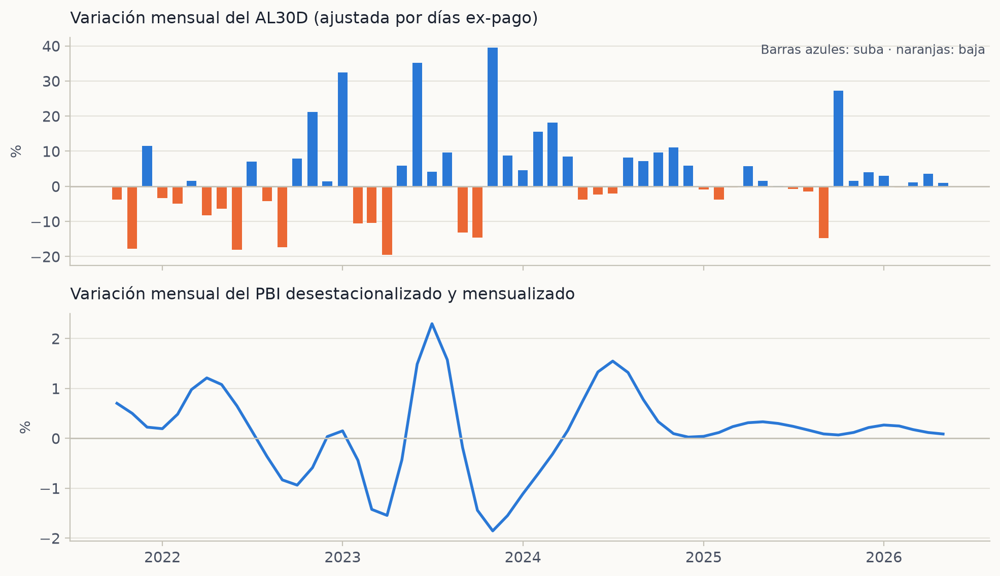
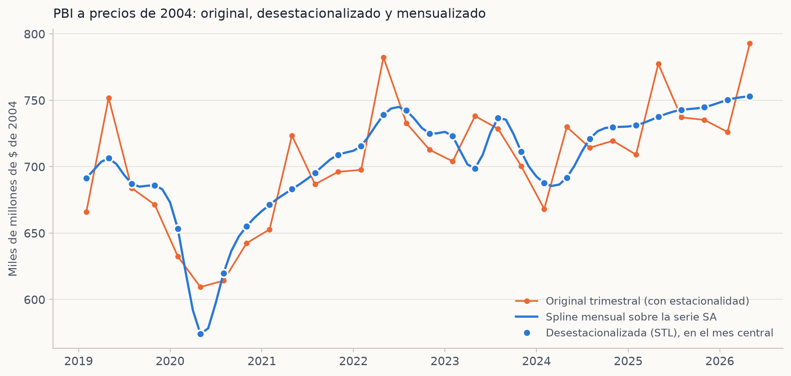
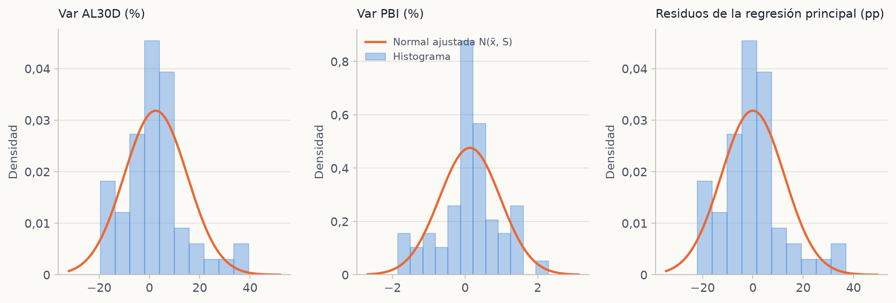
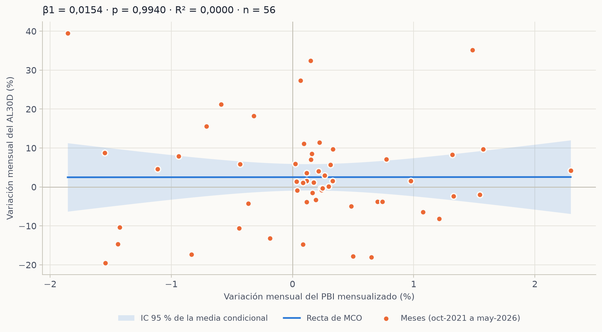
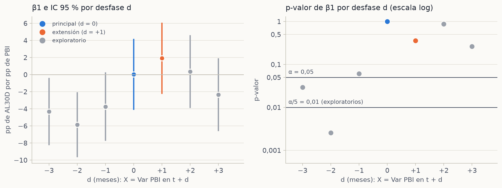
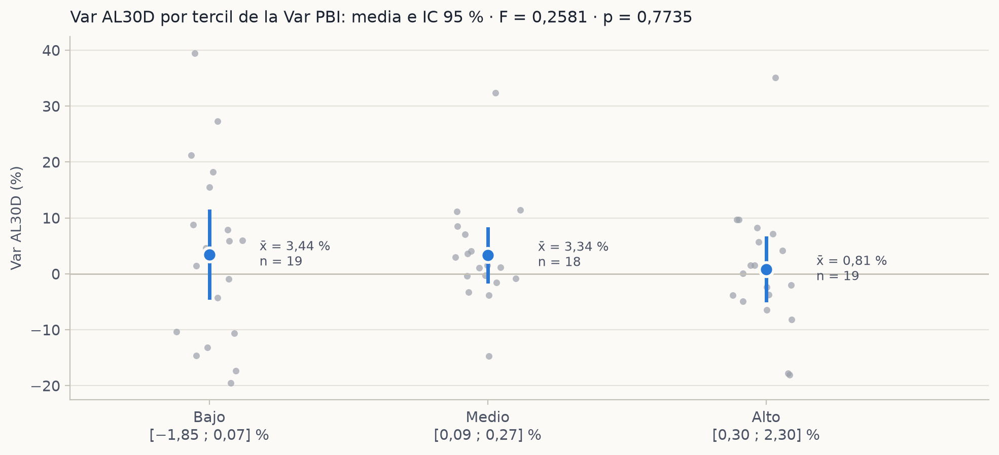
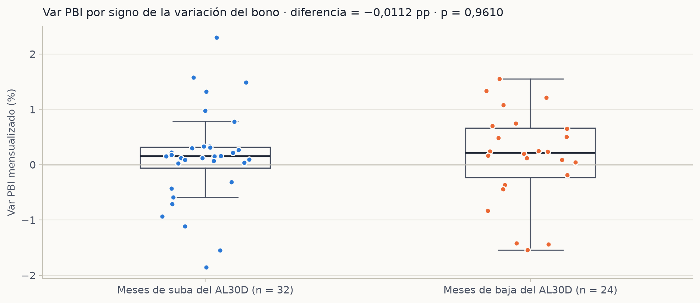
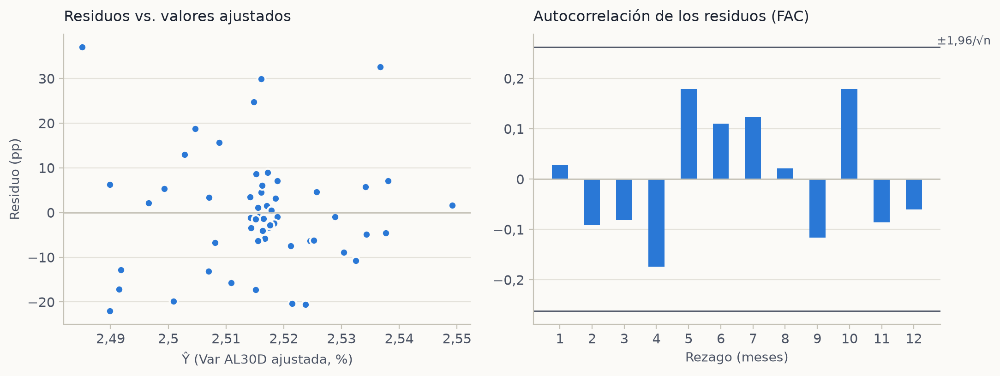
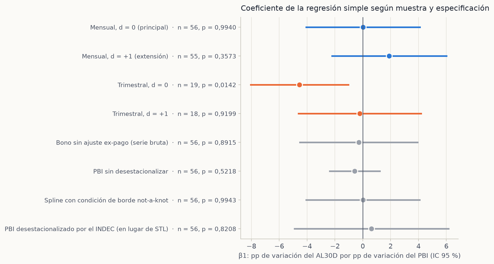

# Variación del PBI real argentino y variación del bono AL30D

**Análisis Estadístico 2** · Cátedra Tito Lasanta · FCE UBA · 2C 2026
Grupo 1: Maria Victoria Acebedo, Matías Rodrigo Bellido, Melina Antonella Escalante, Luka Santino Orpianesi, Manuel Rodriguez

> Documento generado por `python -m tp_ae2.run_all` a partir de `outputs/resultados.json`. Ningún número está escrito a mano.

## 1. Introducción y pregunta de investigación

¿La variación mensual del PBI real argentino se asocia con la variación mensual del precio del bono soberano AL30D? El trabajo contrasta esa asociación con una regresión lineal simple y la acompaña con las demás herramientas de la consigna.

Las variables asignadas al grupo son la **variación del bono soberano argentino** (AL30D, cotización en dólares) y la **variación del PBI argentino** (real, a precios de 2004). El trabajo usa las herramientas obligatorias de la consigna (estimador, intervalo de confianza, bondad de ajuste, regresión lineal simple y múltiple) y ANOVA como herramienta a elección, con 95 % de confianza y el p-valor de cada test.

## 2. Hipótesis

**Hipótesis principal (regresión lineal simple).**

$$\text{Var AL30D}_t = \beta_0 + \beta_1 \cdot \text{Var PBI}_t + \varepsilon_t$$

- $H_0: \beta_1 = 0$. La variación del PBI mensualizado no se asocia de forma estadísticamente significativa con la variación de la cotización del AL30D.
- $H_1: \beta_1 \neq 0$. La variación del PBI mensualizado se asocia de forma estadísticamente significativa con la variación del AL30D.
- Contraste bilateral, $\alpha = 0,05$.

El contraste es bilateral porque no hay una dirección establecida antes de mirar los datos: un PBI más alto puede ir junto con bonos más firmes (mejor capacidad de pago) o con bonos más débiles (por ejemplo, si el crecimiento coincide con más inflación o más presión cambiaria). Un contraste unilateral habría fijado el signo de antemano sin fundamento suficiente.

En una regresión simple el p-valor de β1 coincide con el del coeficiente de correlación r. Por eso invertir cuál variable es la explicada no cambia el p-valor: cambia la interpretación del modelo (pp de bono por pp de PBI, o al revés) y los supuestos que se exigen a los residuos.

La hipótesis se formula como **asociación estadística**: el diseño (datos observacionales, sin variación controlada) no permite inferir causalidad.

**Extensión temporal (declarada a priori).** Se define el desfase $d$ con $X_t = \text{Var PBI}_{t+d}$. $d = 0$ es la hipótesis principal; $d = +1$ (PBI del mes siguiente: el bono se movería antes) es la extensión declarada; $d \in \{-3, -2, -1, +2, +3\}$ son exploratorios y se comparan con $\alpha/5 = 0{,}01$.

**Hipótesis complementaria (enviada a los docentes el 22/10).** La variación porcentual media del PBI real difiere entre los períodos en que el bono sube y aquellos en que baja: $H_0: \mu_{\text{suba}} = \mu_{\text{baja}}$ contra $H_1: \mu_{\text{suba}} \neq \mu_{\text{baja}}$.

## 3. Datos y metodología

| Serie | Fuente | Detalle |
|---|---|---|
| `data_sets_ordenados/02_al30d_diario.csv` | Data912, /historical/bonds/AL30D (cotización en dólares MEP) | 1243 filas, 2021-09-23 a 2026-10-27. Dataset ordenado por el grupo (2026-11-03). Coincide rueda por rueda con la descarga de verificación. |
| `data_sets_ordenados/01_indec_cuentas_nacionales_largo.csv` | INDEC, sh_oferta_demanda_09_26.xls, cuadro 1 (PBI a precios de 2004, trimestral, sin desestacionalizar) | 90 filas, 2004-01-01 a 2026-04-01. Dataset ordenado por el grupo (2026-11-03) a partir de los cuadros del INDEC. Coincide trimestre por trimestre con la serie 9.2_PP2_2004_T_16 de datos.gob.ar. |
| `data/raw/al30.json` | Data912, /historical/bonds/AL30 (cotización en pesos) | 1251 filas, 2021-09-16 a 2026-10-30. Descargado el 2026-11-01. |
| `data/raw/al30c.json` | Data912, /historical/bonds/AL30C (cotización en dólares cable) | 1153 filas, 2021-09-29 a 2026-10-30. Descargado el 2026-11-01. |
| `data_sets_ordenados/01_indec_cuentas_nacionales_largo.csv` | INDEC, sh_oferta_demanda_desest_09_26.xls (PIB desestacionalizado, millones de pesos de 2004) | 90 filas, 2004-01-01 a 2026-04-01. Mismo dataset ordenado (cuadro OD_DESEST_NIVEL). Se usa solo en la sensibilidad (h). |

**Verificación cruzada.** Las series del análisis se compararon con descargas independientes de las mismas fuentes: `data/raw/al30d.json` (Data912, /historical/bonds/AL30D, 1243 filas); `data/raw/pbi_trimestral.csv` (INDEC vía datos.gob.ar, serie 9.2_PP2_2004_T_16, 90 filas). Coinciden valor por valor (lo comprueba `tests/test_datos.py`). Huellas SHA-256, tamaños y rangos en `outputs/linaje_datos.json`.

**Bono.** Cierre diario del AL30D. Log-retorno diario $r_d = \ln(P_d / P_{d-1})$, con $r_d = 0$ en los 5 días ex-pago (2024-07-08: −7,02 %; 2025-01-08: −10,85 %; 2025-07-08: −11,94 %; 2026-01-08: −12,78 %; 2026-07-08: −13,11 %), que son caídas mecánicas por pago de cupón y amortización. Variación del período: $\left(e^{\sum r_d} - 1\right) \cdot 100$. Septiembre de 2021 es un mes parcial y no genera variación. Hubo 1 hueco(s) de más de 5 días corridos entre ruedas (2024-03-27 a 2024-04-03, 7 días).

**PBI.** La serie original es estacional (el segundo trimestre siempre es alto). Se desestacionaliza con STL sobre el logaritmo del nivel (período 4, versión robusta): $\text{SA} = \exp(\ln y - \hat s)$. Factores estacionales medios: T1 0,9597; T2 1,0750; T3 0,9914; T4 0,9779. Los factores implícitos en la serie desestacionalizada que publica el INDEC son T1 0,9566; T2 1,0758; T3 0,9885; T4 0,9798: la STL los reproduce con una diferencia menor a 0,005, y la sensibilidad (h) repite la regresión con la serie del INDEC.Luego se mensualiza con un spline cúbico natural que pasa por cada nivel ubicado en el mes central del trimestre (febrero, mayo, agosto y noviembre), sin extrapolar: la ventana termina en mayo de 2026. $\text{Var PBI}_t = (\text{nivel}_t / \text{nivel}_{t-1} - 1) \cdot 100$.

**Muestras.** Principal: mensual, 2021-10 a 2026-05, n = 56. Respaldo: trimestral sin interpolar, 2021Q4 a 2026Q2, n = 19 (por debajo del mínimo de 50). La muestra mensual con PBI mensualizado **requiere conformidad docente**.

**Decisiones pre-registradas** (fijadas en `config.yaml` antes de ver p-valores): bono AL30D con ajuste ex-pago; PBI con STL y spline natural; hipótesis principal con $d = 0$; extensión $d = +1$; múltiple con la variación del CCL implícito como control; ANOVA por terciles de la Var PBI; complementaria con grupos por signo del bono; $\alpha = 0{,}05$. Todo lo demás se rotula exploratorio, sensibilidad o complementario.

## 4. Desarrollo por herramienta

### 4.1 Estimador

**Por qué.** x̄ y S² son estimadores insesgados de μ y σ² (E[x̄] = μ, E[S²] = σ²) y consistentes: su varianza tiende a cero cuando n crece. Describen cada variable antes de relacionarlas y alimentan el resto de los contrastes.

**Fórmulas.**

$$\bar x = \frac{1}{n}\sum_{i=1}^{n} x_i \qquad S^2 = \frac{1}{n-1}\sum_{i=1}^{n}(x_i - \bar x)^2 \qquad \text{EE}(\bar x) = \frac{S}{\sqrt n} \qquad \hat p = \frac{X}{n}$$

| Variable | n | x̄ | S² | S | EE | Mín. | Máx. | Asimetría | Curtosis (exceso) |
|---|---|---|---|---|---|---|---|---|---|
| Var AL30D (%) | 56 | 2,5158 | 157,0614 | 12,5324 | 1,6747 | −19,5312 | 39,4790 | 0,8124 | 1,3288 |
| Var PBI (%) | 56 | 0,1326 | 0,7025 | 0,8382 | 0,1120 | −1,8547 | 2,2963 | −0,1653 | 0,5267 |
| Var CCL implícito (%) | 56 | 4,3833 | 107,9238 | 10,3886 | 1,3882 | −16,0902 | 32,0382 | 0,6423 | 0,0874 |

- La variación mensual media del AL30D fue 2,5158 % (S = 12,5324 %) y la del PBI, 0,1326 % (S = 0,8382 %): el bono es 15,0 veces más volátil que el PBI.
- El AL30D subió en 32 de 56 períodos (p̂ = 0,5714, EE = 0,0661).
- Autocorrelación de orden 1: 0,7827 en la Var PBI y 0,0275 en la Var AL30D. La del PBI es alta por construcción: el spline reparte cada cambio trimestral en meses contiguos.

### 4.2 Intervalo de confianza (95 %)

**Por qué.** El intervalo acota cada parámetro con 95 % de confianza. Como σ es desconocida, la media usa la t de Student con n − 1 gl; la proporción usa la aproximación Normal (Wald), válida con n·p̂ y n·(1 − p̂) mayores a 5.

$$\bar x \pm t_{\alpha/2;\,n-1}\,\frac{S}{\sqrt n} \qquad \hat p \pm z_{\alpha/2}\sqrt{\frac{\hat p(1-\hat p)}{n}} \qquad b_1 \pm t_{\alpha/2;\,n-2}\,\text{EE}(b_1)$$

| Parámetro | Estimación | EE | Cuantil | IC 95 % |
|---|---|---|---|---|
| μ Var AL30D (%) | 2,5158 | 1,6747 | 2,0040 | [−0,8404 ; 5,8720] |
| μ Var PBI (%) | 0,1326 | 0,1120 | 2,0040 | [−0,0919 ; 0,3570] |
| p (períodos de suba) | 0,5714 | 0,0661 | 1,9600 | [0,4418 ; 0,7010] |
| β1 (d = 0) | 0,0154 | 2,0347 | 2,0049 | [−4,0639 ; 4,0948] |

- μ de la Var AL30D: [−0,8404 ; 5,8720] %. Contiene el 0: no se puede descartar una variación media nula del bono.
- μ de la Var PBI: [−0,0919 ; 0,3570] %. Contiene el 0.
- Proporción de períodos de suba: [0,4418 ; 0,7010]. Contiene 0,5: subas y bajas son compatibles con igual frecuencia.
- β1 (hipótesis principal): [−4,0639 ; 4,0948]. Contiene el 0, en línea con el veredicto.

### 4.3 Bondad de ajuste (χ² a la Normal)

**Por qué.** La inferencia de la regresión (t y F exactas) supone errores normales. El χ² compara las frecuencias observadas con las esperadas bajo N(x̄, S) en k clases equiprobables (esperada ≥ 5, gl = k − 1 − 2 porque se estiman μ y σ). Shapiro-Wilk se suma como complemento porque, con pocas clases, el χ² pierde potencia.

$$\chi^2 = \sum_{j=1}^{k}\frac{(O_j - E_j)^2}{E_j} \sim \chi^2_{k-1-2} \qquad k = \min(8, \lfloor n/5 \rfloor),\; E_j = n/k$$

**Var AL30D** (x̄ = 2,5158, S = 12,5324):

| Clase | Límite inferior | Límite superior | O | E | (O − E)²/E |
|---|---|---|---|---|---|
| 1 | −∞ | −11,9008 | 7 | 7,00 | 0,0000 |
| 2 | −11,9008 | −5,9372 | 4 | 7,00 | 1,2857 |
| 3 | −5,9372 | −1,4775 | 9 | 7,00 | 0,5714 |
| 4 | −1,4775 | 2,5158 | 11 | 7,00 | 2,2857 |
| 5 | 2,5158 | 6,5091 | 8 | 7,00 | 0,1429 |
| 6 | 6,5091 | 10,9688 | 8 | 7,00 | 0,1429 |
| 7 | 10,9688 | 16,9325 | 3 | 7,00 | 2,2857 |
| 8 | 16,9325 | ∞ | 6 | 7,00 | 0,1429 |
| **Total** | | | 56 | 56,00 | **χ² = 6,8571** (gl = 5; valor crítico 11,0705; p = 0,2315) |

**Var PBI** (x̄ = 0,1326, S = 0,8382):

| Clase | Límite inferior | Límite superior | O | E | (O − E)²/E |
|---|---|---|---|---|---|
| 1 | −∞ | −0,8316 | 8 | 7,00 | 0,1429 |
| 2 | −0,8316 | −0,4328 | 3 | 7,00 | 2,2857 |
| 3 | −0,4328 | −0,1345 | 4 | 7,00 | 1,2857 |
| 4 | −0,1345 | 0,1326 | 10 | 7,00 | 1,2857 |
| 5 | 0,1326 | 0,3996 | 16 | 7,00 | 11,5714 |
| 6 | 0,3996 | 0,6979 | 3 | 7,00 | 2,2857 |
| 7 | 0,6979 | 1,0967 | 5 | 7,00 | 0,5714 |
| 8 | 1,0967 | ∞ | 7 | 7,00 | 0,0000 |
| **Total** | | | 56 | 56,00 | **χ² = 19,4286** (gl = 5; valor crítico 11,0705; p = 0,0016) |

**residuos de la regresión principal** (x̄ = −0,0000, S = 12,5324):

| Clase | Límite inferior | Límite superior | O | E | (O − E)²/E |
|---|---|---|---|---|---|
| 1 | −∞ | −14,4166 | 7 | 7,00 | 0,0000 |
| 2 | −14,4166 | −8,4530 | 4 | 7,00 | 1,2857 |
| 3 | −8,4530 | −3,9933 | 9 | 7,00 | 0,5714 |
| 4 | −3,9933 | −0,0000 | 11 | 7,00 | 2,2857 |
| 5 | −0,0000 | 3,9933 | 8 | 7,00 | 0,1429 |
| 6 | 3,9933 | 8,4530 | 8 | 7,00 | 0,1429 |
| 7 | 8,4530 | 14,4166 | 3 | 7,00 | 2,2857 |
| 8 | 14,4166 | ∞ | 6 | 7,00 | 0,1429 |
| **Total** | | | 56 | 56,00 | **χ² = 6,8571** (gl = 5; valor crítico 11,0705; p = 0,2315) |

- Var AL30D: χ² = 6,8571 con 5 gl, p = 0,2315 (no se rechaza H0); Shapiro-Wilk W = 0,9390, p = 0,0070 (se rechaza H0). Los dos tests discrepan: con pocas clases el χ² tiene poca potencia, así que el resultado de Shapiro-Wilk es el más informativo sobre la forma de la distribución.
- Var PBI: χ² = 19,4286 con 5 gl, p = 0,0016 (se rechaza H0); Shapiro-Wilk W = 0,9542, p = 0,0327 (se rechaza H0).
- residuos de la regresión principal: χ² = 6,8571 con 5 gl, p = 0,2315 (no se rechaza H0); Shapiro-Wilk W = 0,9390, p = 0,0070 (se rechaza H0). Los dos tests discrepan: con pocas clases el χ² tiene poca potencia, así que el resultado de Shapiro-Wilk es el más informativo sobre la forma de la distribución.

### 4.4 Regresión lineal simple (hipótesis principal)

**Por qué.** Es la herramienta que responde la pregunta: estima cuánto cambia en promedio la variación del bono por cada punto porcentual de variación del PBI, y el estadístico t de β1 contrasta H0: β1 = 0 con n − 2 gl.

$$b_1 = \frac{S_{xy}}{S_{xx}},\quad b_0 = \bar y - b_1 \bar x,\quad S^2 = \frac{SCE}{n-2},\quad \text{EE}(b_1) = \sqrt{\frac{S^2}{S_{xx}}},\quad t = \frac{b_1}{\text{EE}(b_1)} \sim t_{n-2}$$

$$S_{xx} = \sum x^2 - n\bar x^2,\qquad S_{xy} = \sum xy - n\bar x\bar y,\qquad R^2 = 1 - \frac{SCE}{SCT},\qquad F = \frac{SCR/1}{SCE/(n-2)}$$

**Cuadro de cálculo a mano** (detalle por observación en `outputs/tablas/cuadro_a_mano.csv`): n = 56, Σx = 7,4229, Σy = 140,8852, Σx² = 39,6235, Σy² = 8.992,8144, Σxy = 19,2712.

**Desarrollo.** x̄ = 0,1326; ȳ = 2,5158; Sxx = 38,6396; Sxy = 0,5967; Syy = 8.638,3743.
b1 = 0,5967 / 38,6396 = **0,0154**; b0 = 2,5158 − (0,0154)·(0,1326) = **2,5138**.
SCE = 8.638,3651; S² = 159,9697; EE(b1) = 2,0347; t = 0,0076 con 54 gl (valor crítico ±2,0049); **p = 0,9940**. R² = 0,0000; r = 0,0010; F = 0,0001 (p = 0,9940).

| Coeficiente | Estimación | EE | t | p-valor | IC 95 % |
|---|---|---|---|---|---|
| β0 | 2,5138 | 1,7115 | 1,4687 | 0,1477 | [−0,9177 ; 5,9452] |
| β1 | 0,0154 | 2,0347 | 0,0076 | 0,9940 | [−4,0639 ; 4,0948] |

- NO HAY EVIDENCIA SUFICIENTE para afirmar la hipótesis principal (β1 = 0,0154; IC 95 % [−4,0639 ; 4,0948]; p = 0,9940; R² = 0,0000). No haber rechazado H0 no prueba que β1 sea cero.
- Pendiente positiva: en la muestra, cada 1 pp adicional de variación mensual del PBI se asocia, en promedio, con 0,0154 pp más de variación mensual del AL30D.

**Método de las sumas de cuadrados.** El método de las sumas de cuadrados descompone la variabilidad total del bono (SCT) en la parte que explica la recta (SCR) y la que queda en el error (SCE). Si el PBI explicara algo, SCR sería grande frente a SCE. El cociente de sus cuadrados medios es el estadístico F, y SCR/SCT es el coeficiente de determinación R².

$$SCT = SCR + SCE,\qquad SCR = b_1 S_{xy},\qquad F = \frac{CMR}{CME} = \frac{SCR/1}{SCE/(n-2)},\qquad R^2 = \frac{SCR}{SCT}$$

| Fuente | Suma de cuadrados | gl | Cuadrado medio | F | p-valor |
|---|---|---|---|---|---|
| Regresión (explicada por el PBI) | 0,0092 | 1 | 0,0092 | 0,0001 | 0,9940 |
| Error (no explicada) | 8.638,3651 | 54 | 159,9697 | | |
| Total | 8.638,3743 | 55 | | | |

- Regresión simple: SCR = 0,0092 de SCT = 8.638,37, así que R² = SCR/SCT = 0,0000. F = CMR/CME = 0,0092/159,97 = 0,0001 con (1; 54) gl, frente a un valor crítico de 4,02: p = 0,9940 (no se rechaza H0). En la regresión simple F = t², así que la decisión coincide con la del test t de β1.

**Proyección por escenarios.** Con la recta de la hipótesis se proyecta la variación del bono para escenarios de variación del PBI. Para cada escenario hay dos rangos al 95 %: el del valor esperado (IC de la media) y el de un período concreto (intervalo de predicción), que suma la variabilidad propia del bono. Es la mirada actuarial de la hipótesis: si el PBI sirviera para anticipar el bono, cambiaría la proyección y achicaría el rango.

$$\hat y_0 = b_0 + b_1 x_0,\qquad IC_{95\%}(\text{media}) = \hat y_0 \pm t_{n-2}\, S \sqrt{\frac{1}{n} + \frac{(x_0 - \bar x)^2}{S_{xx}}},\qquad IP_{95\%} = \hat y_0 \pm t_{n-2}\, S \sqrt{1 + \frac{1}{n} + \frac{(x_0 - \bar x)^2}{S_{xx}}}$$

| Escenario | Var PBI | Var AL30D proyectada | IC 95 % de la media | Intervalo de predicción 95 % |
|---|---|---|---|---|
| Recesión | −1,00 % | +2,50 % | [−3,23 ; 8,23] % | [−23,50 ; 28,50] % |
| Estancamiento | 0,00 % | +2,51 % | [−0,92 ; 5,95] % | [−23,07 ; 28,10] % |
| Crecimiento | +1,00 % | +2,53 % | [−2,37 ; 7,43] % | [−23,30 ; 28,36] % |
| Crecimiento fuerte | +2,00 % | +2,54 % | [−5,79 ; 10,88] % | [−24,15 ; 29,24] % |

- Entre los escenarios de −1,0 % y +2,0 % de variación mensual del PBI, la variación proyectada del bono va de +2,50 % a +2,54 %, casi igual a su promedio (+2,52 %), con un intervalo de predicción de unos ±26 pp. Conocer el PBI no cambia la proyección ni reduce la incertidumbre sobre el bono.

### 4.5 Extensión temporal y desfases

**Por qué.** Los docentes sugirieron mirar la dimensión temporal. Se define X = Var PBI en t + d. El desfase d = +1 (el bono se mueve antes que el PBI) se declaró antes de ver resultados; d = −3, −2, −1, +2 y +3 son exploratorios y se comparan con α/5 = 0,01 para controlar las comparaciones múltiples.

| d | Etiqueta | n | β1 | EE | t | p-valor | Umbral | IC 95 % | R² |
|---|---|---|---|---|---|---|---|---|---|
| −3 | exploratoria | 56 | −4,3165 | 1,9262 | −2,2409 | 0,0292 | 0,01 | [−8,1784 ; −0,4546] | 0,0851 |
| −2 | exploratoria | 56 | −5,8701 | 1,8536 | −3,1668 | 0,0025 | 0,01 | [−9,5864 ; −2,1538] | 0,1566 |
| −1 | exploratoria | 56 | −3,7515 | 1,9598 | −1,9143 | 0,0609 | 0,01 | [−7,6805 ; 0,1776] | 0,0635 |
| 0 | principal | 56 | 0,0154 | 2,0347 | 0,0076 | 0,9940 | 0,05 | [−4,0639 ; 4,0948] | 0,0000 |
| +1 | extensión | 55 | 1,8997 | 2,0458 | 0,9286 | 0,3573 | 0,05 | [−2,2037 ; 6,0030] | 0,0160 |
| +2 | exploratoria | 54 | 0,3358 | 2,0854 | 0,1610 | 0,8727 | 0,01 | [−3,8489 ; 4,5205] | 0,0005 |
| +3 | exploratoria | 53 | −2,3590 | 2,0803 | −1,1340 | 0,2621 | 0,01 | [−6,5355 ; 1,8174] | 0,0246 |

- NO HAY EVIDENCIA SUFICIENTE para afirmar la extensión temporal (d = +1) (β1 = 1,8997; IC 95 % [−2,2037 ; 6,0030]; p = 0,3573; R² = 0,0160). No haber rechazado H0 no prueba que β1 sea cero.
- Desfases exploratorios con p < 0,01: d = −2 (β1 = −5,8701, p = 0,0025). Al ser exploratorios no confirman nada por sí solos: señalan una relación a contrastar con datos nuevos, y comparten la limitación del spline (la Var PBI mensual de meses vecinos está muy correlacionada).

### 4.6 Regresión lineal múltiple

**Por qué.** Agrega un control, la variación del CCL implícito (AL30 en pesos / AL30C en dólares cable), para ver si la asociación con el PBI cambia cuando esa variable se mantiene constante. El control requiere aprobación docente, porque la consigna habla de variables dadas. Además, el AL30D y el CCL implícito salen del mismo instrumento: si el dólar sube y el precio en pesos no, el precio en dólares baja, así que parte de la relación entre ambos es mecánica.

$$\hat\beta = (X'X)^{-1}X'y,\qquad \widehat{\text{Var}}(\hat\beta) = S^2 (X'X)^{-1},\qquad S^2 = \frac{e'e}{n-k-1},\qquad F = \frac{(SCT - SCE)/k}{SCE/(n-k-1)}$$

| Coeficiente | Estimación | EE | t | p-valor | IC 95 % |
|---|---|---|---|---|---|
| constante | 3,5270 | 1,8518 | 1,9046 | 0,0623 | [−0,1873 ; 7,2413] |
| Var PBI | −0,2222 | 2,0258 | −0,1097 | 0,9131 | [−4,2854 ; 3,8411] |
| Var CCL implícito | −0,2240 | 0,1634 | −1,3703 | 0,1764 | [−0,5518 ; 0,1039] |

n = 56, k = 2, gl = 53; R² = 0,0342; R² ajustado = −0,0022; S = 12,5464; F = 0,9389 con (2; 53) gl, p = 0,3975.

| Fuente | Suma de cuadrados | gl | Cuadrado medio | F | p-valor |
|---|---|---|---|---|---|
| Regresión (PBI y control) | 295,5820 | 2 | 147,7910 | 0,9389 | 0,3975 |
| Error | 8.342,7923 | 53 | 157,4112 | | |
| Total | 8.638,3743 | 55 | | | |

- Regresión múltiple: SCR = 295,5820 de SCT = 8.638,37, así que R² = SCR/SCT = 0,0342. F = CMR/CME = 147,7910/157,41 = 0,9389 con (2; 53) gl, frente a un valor crítico de 3,17: p = 0,3975 (no se rechaza H0).

- Ŷ = 3,5270 − 0,2222·Var PBI − 0,2240·Var CCL implícito. R² = 0,0342, R² ajustado = −0,0022, S = 12,5464 pp; F = 0,9389 con (2; 53) gl, p = 0,3975 (no se rechaza H0: no hay evidencia de que el modelo en conjunto se asocie con Y).
- t de Var PBI = −0,1097, p = 0,9131; t de Var CCL implícito = −1,3703, p = 0,1764.
- Supuestos de Gauss-Markov. Linealidad: ver residuos vs. ajustados. Homocedasticidad: Breusch-Pagan p = 0,1870 (no se rechaza H0). No autocorrelación: Durbin-Watson = 1,9475 y Breusch-Godfrey (3 rezagos) p = 0,9030 (no se rechaza H0). No multicolinealidad: correlación entre regresores −0,0856 y VIF Var PBI 1,01, Var CCL implícito 1,01 (valores mayores a 5 o 10 serían preocupantes). Normalidad de residuos: Shapiro-Wilk p = 0,0077.
- Sensibilidad con errores HAC (Newey-West, 3 rezagos): el β de la Var PBI tiene p = 0,9455, frente a p = 0,9131 con errores clásicos.

### 4.7 ANOVA de un factor

**Por qué.** Es la herramienta a elección del grupo. Compara la variación media del bono entre tres niveles de la variación del PBI (terciles: bajo, medio y alto) sin imponer una relación lineal. Los terciles se arman con X, no con Y, y dejan grupos balanceados.

$$SC_{\text{entre}} = \sum_{j} n_j(\bar y_j - \bar y)^2,\quad SC_{\text{dentro}} = \sum_j\sum_i (y_{ij} - \bar y_j)^2,\quad F = \frac{SC_{\text{entre}}/(k-1)}{SC_{\text{dentro}}/(N-k)},\quad \eta^2 = \frac{SC_{\text{entre}}}{SC_{\text{total}}}$$

| Fuente | SC | gl | CM | F | p-valor |
|---|---|---|---|---|---|
| Entre grupos | 83,3205 | 2 | 41,6603 | 0,2581 | 0,7735 |
| Dentro de grupos | 8.555,0538 | 53 | 161,4161 | | |
| Total | 8.638,3743 | 55 | | | |

| Tercil de Var PBI | Rango de Var PBI (%) | n | Media Var AL30D (%) | S | IC 95 % |
|---|---|---|---|---|---|
| bajo | [−1,85 ; 0,07] | 19 | 3,4406 | 16,0598 | [−4,3000 ; 11,1812] |
| medio | [0,09 ; 0,27] | 18 | 3,3353 | 9,4444 | [−1,3613 ; 8,0319] |
| alto | [0,30 ; 2,30] | 19 | 0,8147 | 11,5378 | [−4,7464 ; 6,3757] |

- F = 0,2581 con (2; 53) gl, p = 0,7735: no se rechaza H0. No hay evidencia de que la variación media del bono difiera entre los niveles del PBI. η² = 0,0096.
- Medias por tercil: bajo 3,4406 % (n = 19); medio 3,3353 % (n = 18); alto 0,8147 % (n = 19).
- Supuestos: Levene p = 0,0518 (no se rechaza H0: varianzas homogéneas); normalidad por grupo (Shapiro-Wilk): bajo p = 0,6217; medio p = 0,0088; alto p = 0,0407. La independencia no se puede garantizar en una serie de tiempo: meses consecutivos comparten contexto macroeconómico.
- Sensibilidad con umbrales fijos de ±0,5 %: F = 0,3023, p = 0,7404 (n por grupo 10/32/14).

### 4.8 Prueba complementaria (hipótesis enviada a los docentes)

**Por qué.** Es la hipótesis que el grupo envió a los docentes el 22/10 y sobre la que recibió devoluciones (no consta una aprobación formal). Invierte el planteo: Y = Var PBI y los grupos se forman por el signo de la variación del bono. Primero se contrasta la igualdad de varianzas con la F; si no se rechaza, t con varianza agrupada; si se rechaza, Welch.

$$F = \frac{S_1^2}{S_2^2},\qquad t = \frac{\bar x_1 - \bar x_2}{S_p\sqrt{\frac{1}{n_1} + \frac{1}{n_2}}},\qquad S_p^2 = \frac{(n_1-1)S_1^2 + (n_2-1)S_2^2}{n_1 + n_2 - 2},\qquad d = \frac{\bar x_1 - \bar x_2}{S_p}$$

| Prueba | Estadístico | gl | p-valor | Decisión |
|---|---|---|---|---|
| F de igualdad de varianzas | 1,0401 | 31; 23 | 0,9357 | No se rechaza H0 |
| t con varianza agrupada | −0,0491 | 54,00 | 0,9610 | No se rechaza H0 |
| t de Welch | −0,0492 | 50,21 | 0,9609 | No se rechaza H0 |

- NO HAY EVIDENCIA SUFICIENTE para afirmar la hipótesis complementaria (diferencia suba − baja = −0,0112 pp; IC 95 % [−0,4692 ; 0,4467]; p = 0,9610). No haber rechazado H0 no prueba que las medias sean iguales.
- F de varianzas = 1,0401 con (31; 23) gl, p = 0,9357: no se rechaza H0, por eso decide la t varianza agrupada (t = −0,0491, 54,00 gl). Welch da p = 0,9609.
- Medias de la Var PBI: 0,1277 % en 32 períodos de suba y 0,1390 % en 24 de baja. d de Cohen = −0,0133. Con estos tamaños, la diferencia mínima detectable con 80 % de potencia es 0,6516 pp (d = 0,7703).
- Advertencia: la Var PBI mensual sale de un spline, así que las observaciones dentro de cada grupo están autocorrelacionadas (orden 1: 0,7827). El test supone independencia, de modo que su p-valor es optimista. La versión trimestral, sin interpolar, es el control.

## 5. Supuestos y diagnósticos

| Diagnóstico | Regresión simple | Regresión múltiple |
|---|---|---|
| Durbin-Watson | 1,9399 | 1,9475 |
| Breusch-Godfrey (LM, p) | 0,8606; p = 0,8349 | 0,5713; p = 0,9030 |
| Breusch-Pagan (LM, p) | 3,5757; p = 0,0586 | 3,3528; p = 0,1870 |
| Shapiro-Wilk de residuos | W = 0,9390; p = 0,0070 | W = 0,9399; p = 0,0077 |
| VIF | — | Var PBI: 1,01; Var CCL implícito: 1,01 |

## 6. Robustez

La muestra trimestral usa la información sin interpolar, con su propio n (19, por debajo del mínimo de 50 de la consigna). Muestra si el veredicto depende de la mensualización. Las sensibilidades cambian una decisión por vez.

| Especificación | Muestra | n | Coeficiente | IC 95 % | Estadístico | p-valor | Decisión |
|---|---|---|---|---|---|---|---|
| Hipótesis principal: β1 (d = 0) | mensual | 56 | 0,0154 | [−4,0639 ; 4,0948] | t = 0,0076 | 0,9940 | No se rechaza H0 |
| Hipótesis principal: β1 (d = 0) | trimestral | 19 | −4,5407 | [−8,0455 ; −1,0359] | t = −2,7334 | 0,0142 | Se rechaza H0 |
| Extensión: β1 (d = +1) | mensual | 55 | 1,8997 | [−2,2037 ; 6,0030] | t = 0,9286 | 0,3573 | No se rechaza H0 |
| Extensión: β1 (d = +1) | trimestral | 18 | −0,2123 | [−4,6161 ; 4,1915] | t = −0,1022 | 0,9199 | No se rechaza H0 |
| Múltiple: β de Var PBI | mensual | 56 | −0,2222 | [−4,2854 ; 3,8411] | t = −0,1097 | 0,9131 | No se rechaza H0 |
| Múltiple: β de Var PBI | trimestral | 19 | −4,5576 | [−8,0636 ; −1,0515] | t = −2,7557 | 0,0141 | Se rechaza H0 |
| ANOVA por terciles del PBI | mensual | 56 | — | — | F = 0,2581 | 0,7735 | No se rechaza H0 |
| ANOVA por terciles del PBI | trimestral | 19 | — | — | F = 4,5416 | 0,0274 | Se rechaza H0 |
| Complementaria: μ suba − μ baja (Var PBI) | mensual | 56 | −0,0112 | [−0,4692 ; 0,4467] | t = −0,0491 | 0,9610 | No se rechaza H0 |
| Complementaria: μ suba − μ baja (Var PBI) | trimestral | 19 | −2,2177 | [−4,4181 ; −0,0173] | t = −2,1264 | 0,0484 | Se rechaza H0 |

**Sensibilidades** (cada una cambia una sola decisión):

| Especificación | n | Estadístico | p-valor | Decisión |
|---|---|---|---|---|
| Especificación principal (referencia) | 56 | t = 0,0076 | 0,9940 | No se rechaza H0 |
| (a) Bono sin ajuste ex-pago (serie bruta) | 56 | t = −0,1370 | 0,8915 | No se rechaza H0 |
| (b) PBI sin desestacionalizar | 56 | t = −0,6448 | 0,5218 | No se rechaza H0 |
| (c) ANOVA con umbrales ±0,5 % (n por grupo 10/32/14) | 56 | F = 0,3023 | 0,7404 | No se rechaza H0 |
| (d) Spline con condición de borde not-a-knot | 56 | t = 0,0072 | 0,9943 | No se rechaza H0 |
| (e) Muestra trimestral (n = 19) | 19 | t = −2,7334 | 0,0142 | Se rechaza H0 |
| (f) Múltiple con errores HAC (Newey-West, 3 rezagos): β de Var PBI | 56 | t = −0,0687 | 0,9455 | No se rechaza H0 |
| (g) Múltiple con CCL de cierres operados (AL30C con volumen > 0): β de Var PBI | 52 | t = −0,1902 | 0,8499 | No se rechaza H0 |
| (g) Múltiple con CCL de cierres operados (AL30C con volumen > 0): β de Var CCL | 52 | t = −1,4465 | 0,1544 | No se rechaza H0 |
| (h) PBI desestacionalizado por el INDEC (en lugar de STL) | 56 | t = 0,2276 | 0,8208 | No se rechaza H0 |

- El veredicto de la hipótesis principal cambia con la muestra trimestral: β1 = −4,5407 (IC 95 % [−8,0455 ; −1,0359]; p = 0,0142; R² = 0,3053), frente a β1 = 0,0154 (p = 0,9940) en la mensual. El signo es opuesto.
- Sensibilidades: (a) Bono sin ajuste ex-pago (serie bruta): p = 0,8915 (no se rechaza H0); (b) PBI sin desestacionalizar: p = 0,5218 (no se rechaza H0); (c) ANOVA con umbrales ±0,5 % (n por grupo 10/32/14): p = 0,7404 (no se rechaza H0); (d) Spline con condición de borde not-a-knot: p = 0,9943 (no se rechaza H0); (e) Muestra trimestral (n = 19): p = 0,0142 (se rechaza H0); (f) Múltiple con errores HAC (Newey-West, 3 rezagos): β de Var PBI: p = 0,9455 (no se rechaza H0); (g) Múltiple con CCL de cierres operados (AL30C con volumen > 0): β de Var PBI: p = 0,8499 (no se rechaza H0); (g) Múltiple con CCL de cierres operados (AL30C con volumen > 0): β de Var CCL: p = 0,1544 (no se rechaza H0); (h) PBI desestacionalizado por el INDEC (en lugar de STL): p = 0,8208 (no se rechaza H0).

**Influencia por período.** Influencia en la muestra trimestral (diagnóstico posterior, no pre-registrado): al excluir un período por vez, la decisión (se rechaza H0) se mantiene en 18 de 19 casos y cambia al excluir 2024Q1 (p = 0,0527); el p-valor va de 0,0047 a 0,0527. En los 5 períodos con caída del PBI el bono subió en 5; en los 14 con suba del PBI, subió en 7. La distancia de Cook es $D_i = \dfrac{e_i^2}{p \, s^2} \cdot \dfrac{h_{ii}}{(1 - h_{ii})^2}$, con $p = 2$ y palanca $h_{ii} = \frac{1}{n} + \frac{(x_i - \bar x)^2}{S_{xx}}$; se marca con * cuando supera $4/n = 0,2105$.

| Período | Var AL30D (%) | Var PBI (%) | Cook | β1 sin el período | p-valor sin el período | Decisión |
|---|---|---|---|---|---|---|
| 2021Q4 | −11,91 | 1,96 | 0,0226 | −4,3484 | 0,0213 | Se rechaza H0 |
| 2022Q1 | −6,70 | 0,90 | 0,0148 | −4,4858 | 0,0172 | Se rechaza H0 |
| 2022Q2 | −29,60 | 3,30 | 0,1721 | −3,7861 | 0,0370 | Se rechaza H0 |
| 2022Q3 | −15,27 | 0,44 | 0,0518 | −4,5433 | 0,0125 | Se rechaza H0 |
| 2022Q4 | 32,58 | −2,34 | 0,0481 | −4,1456 | 0,0307 | Se rechaza H0 |
| 2023Q1 | 6,09 | −0,26 | 0,0020 | −4,5712 | 0,0168 | Se rechaza H0 |
| 2023Q2 | 15,12 | −3,37 | 0,0452 | −4,9667 | 0,0155 | Se rechaza H0 |
| 2023Q3 | −0,81 | 5,45 | 0,2260 * | −5,5528 | 0,0106 | Se rechaza H0 |
| 2023Q4 | 29,49 | −3,45 | 0,0119 | −4,3211 | 0,0334 | Se rechaza H0 |
| 2024Q1 | 42,88 | −3,33 | 0,1761 | −3,7018 | 0,0527 | No se rechaza H0 |
| 2024Q2 | 1,98 | 0,58 | 0,0021 | −4,5344 | 0,0173 | Se rechaza H0 |
| 2024Q3 | 13,63 | 4,26 | 0,2932 * | −5,6252 | 0,0047 | Se rechaza H0 |
| 2024Q4 | 29,11 | 1,21 | 0,0742 | −4,7387 | 0,0089 | Se rechaza H0 |
| 2025Q1 | −5,02 | 0,18 | 0,0186 | −4,5771 | 0,0150 | Se rechaza H0 |
| 2025Q2 | 7,46 | 0,88 | 0,0006 | −4,5508 | 0,0172 | Se rechaza H0 |
| 2025Q3 | −16,72 | 0,70 | 0,0535 | −4,4811 | 0,0135 | Se rechaza H0 |
| 2025Q4 | 34,46 | 0,27 | 0,0728 | −4,4935 | 0,0116 | Se rechaza H0 |
| 2026Q1 | 3,80 | 0,73 | 0,0004 | −4,5348 | 0,0175 | Se rechaza H0 |
| 2026Q2 | 4,93 | 0,38 | 0,0007 | −4,5424 | 0,0173 | Se rechaza H0 |

## 7. Limitaciones

- Mensualización: la información real del PBI en la ventana son 20 trimestres; la forma dentro de cada trimestre la construye el spline. El n efectivo de X es menor al nominal (autocorrelación de orden 1 de la Var PBI mensual: 0,7827).
- Información hacia adelante: el spline usa los trimestres siguientes para fijar cada mes, y la STL es un filtro de dos lados. El valor de un mes incorpora datos que en ese momento no se conocían.
- Error de medición en X: la Var PBI mensual es una aproximación; ese error atenúa β1 hacia cero.
- Durbin-Watson: 1,9399 en la regresión simple. Era esperable un valor cercano a 2 porque la variación mensual del bono tiene poca autocorrelación; se calculó en lugar de suponerlo.
- Ajuste ex-pago: los días de pago de cupón y amortización llevan retorno 0. Sin el ajuste, esas caídas mecánicas (−7,0 %, −10,9 %, −11,9 %, −12,8 %, −13,1 %) se leerían como pérdidas de precio.
- Período corto (2021-2026) con pocos ciclos completos de actividad, y observaciones no independientes: períodos consecutivos comparten contexto macroeconómico.
- Comparaciones múltiples: siete desfases y varias especificaciones. Por eso los exploratorios se juzgan con α/5 = 0,01 y cada resultado lleva su etiqueta.
- CCL implícito: parte de su relación con el AL30D es mecánica (mismo instrumento) y el AL30C fue poco líquido: no operó en el 67 % de las ruedas de 2022, así que varios cierres de mes repiten un precio viejo. La sensibilidad (g) usa solo cierres operados.
- Muestra trimestral: n = 19, por debajo del mínimo de 50 de la consigna; se presenta como control de robustez, no como resultado principal.

## 8. Conclusión

### Respuesta a la pregunta

Con los datos de octubre de 2021 a mayo de 2026 (n = 56 meses), **no se encontró evidencia estadística suficiente para afirmar que exista una asociación lineal contemporánea entre la variación mensual del PBI real argentino (mensualizado) y la variación mensual del bono AL30D**. La pendiente estimada es β1 = 0,0154, con IC 95 % [−4,0639 ; 4,0948] y p = 0,9940. El coeficiente de determinación es prácticamente nulo (R² ≈ 0,000001): el modelo explica prácticamente el 0 % de la variabilidad del bono. Por lo tanto, no se rechaza H0: β1 = 0.

Las otras dos hipótesis llegan al mismo resultado:

- **Extensión temporal (d = +1).** El PBI del mes siguiente tampoco se asocia con el bono: β1 = 1,8997; p = 0,3573.
- **Hipótesis enviada a los docentes.** La variación media del PBI en los meses de suba del bono no difiere de la de los meses de baja: diferencia = −0,0112 pp, IC 95 % [−0,4692 ; 0,4467], p = 0,9610. La prueba F no rechazó la igualdad de varianzas (p = 0,9357), así que la decisión se tomó con el t de varianza agrupada, como indica la regla de la cátedra.

Las herramientas restantes son coherentes con eso. El ANOVA por terciles del PBI da F = 0,2581 (p = 0,7735). En la regresión múltiple con el CCL implícito como control, el F global da p = 0,3975 y el coeficiente del PBI, p = 0,9131.

### Qué permiten descartar los datos

No haber rechazado H0 no prueba que la relación sea nula, pero los intervalos acotan su tamaño:

- **Sumas de cuadrados.** De la variabilidad total del bono (SCT = 8.638,37), la recta explica SCR = 0,0092: R² = SCR/SCT = 0,0000 y F = 0,0001 con (1; 54) gl, p = 0,9940, el mismo resultado que el test t.
- **Regresión.** Aun en el extremo del IC de β1, un desvío estándar de la variación mensual del PBI (0,8382 pp) se asociaría con unos 3,4 pp de variación del bono, mientras que el desvío del propio bono es 12,5324 pp. Si existe una relación lineal, explica una parte chica de lo que se mueve el AL30D en un mes.
- **Proyección por escenarios.** Con la recta estimada, para cualquier escenario de PBI entre −1 % y +2 % mensual el bono se proyecta entre +2,50 % y +2,54 %, prácticamente su promedio, con un intervalo de predicción de unos ±26 pp. En términos actuariales, conocer el PBI no cambia la proyección ni reduce la incertidumbre sobre el bono.
- **Diferencia de medias.** Con 80 % de potencia, la diferencia mínima detectable es 0,6516 pp. Una diferencia de ese tamaño en el crecimiento mensual medio del PBI entre meses de suba y de baja del bono probablemente se habría detectado; una menor no se puede descartar.

### Qué tan sólido es el resultado

- **Sensibilidades.** Ninguna de las variantes sobre la muestra mensual cambia el veredicto. En la regresión simple: bono sin ajuste ex-pago (p = 0,8915), PBI sin desestacionalizar (p = 0,5218), spline not-a-knot (p = 0,9943) y PBI desestacionalizado por el INDEC en lugar de STL (p = 0,8208). En la múltiple, para el coeficiente del PBI: errores HAC (p = 0,9455) y CCL con cierres operados (p = 0,8499).
- **Supuestos.** Durbin-Watson (1,9399) y Breusch-Godfrey (p = 0,8349) no muestran autocorrelación de los residuos. Breusch-Pagan no rechaza la homocedasticidad, aunque queda cerca del umbral (p = 0,0586). Los residuos no son normales (Shapiro-Wilk p = 0,0070). Con n = 56 el t de β1 es aproximadamente válido, y los errores HAC, que no suponen homocedasticidad ni normalidad, llevan a la misma decisión.
- **La excepción: la muestra trimestral.** En el análisis trimestral, sin mensualizar el PBI (n = 19), se obtuvo una pendiente negativa y estadísticamente significativa (β1 = −4,5407; IC 95 % [−8,0455 ; −1,0359]; p = 0,0142). Su signo difiere del de la estimación mensual (β1 = 0,0154), que no se distingue de cero, y el resultado debe interpretarse con cautela por tres motivos. En primer lugar, la muestra tiene 19 observaciones, por debajo del mínimo de 50 que pide la consigna; esto es una limitación respecto de la consigna y no demuestra que el resultado sea falso. En segundo lugar, la decisión estadística es sensible a la exclusión de 2024Q1: sin esa observación, el valor p pasa a 0,0527 y deja de ser significativo al 5 %, y es el único trimestre cuya exclusión cambia la decisión. En tercer lugar, el patrón se concentra en los 5 trimestres con caída del PBI, en los cuales el bono subió; en los 14 trimestres con suba del PBI, el bono subió en 7, es decir, en la mitad. El desfase exploratorio d = −2 apunta al mismo signo (β1 = −5,8701; p = 0,0025, menor que el umbral de 0,01), pero es exploratorio y comparte la limitación del spline.

### Lectura de los resultados

Los resultados indican que las variaciones contemporáneas del PBI real (mensualizado) no presentan una asociación lineal estadísticamente significativa con las variaciones del AL30D durante el período analizado. Una posible interpretación económica es que el precio del bono también responda a factores vinculados con las expectativas sobre la capacidad de pago del Estado, como la situación fiscal, las reservas internacionales y el riesgo de default. Sin embargo, estas variables no se incorporaron directamente al modelo, por lo que esta interpretación es una conjetura explicativa y no una conclusión demostrada por el trabajo. En la muestra trimestral, los cinco trimestres con caída del PBI y suba del bono están entre 2022Q4 y 2024Q1, un tramo que incluye la sequía de 2023, las elecciones presidenciales y el cambio de gobierno de diciembre de 2023 con el ajuste fiscal posterior. Los dos con mayor suba del bono son 2024Q1 (+42,88 % con el PBI en −3,33 %) y 2022Q4 (+32,58 % con −2,34 %). Es un patrón de pocos trimestres, no una relación establecida.

### Limitaciones y próximos pasos

Las limitaciones están detalladas en la sección 7. Las que más pesan son tres: la muestra mensual se apoya en solo 20 trimestres reales de PBI, el período es corto (2021-2026) y hay varias especificaciones y desfases, que obligan a separar lo confirmatorio de lo exploratorio.

Para seguir:

- Repetir el contraste con una serie de bonos soberanos en dólares más larga (por ejemplo, un índice de riesgo país), que dé más de 50 trimestres sin interpolar.
- Plantear de antemano la hipótesis que sugiere la muestra trimestral (β1 < 0: el bono sube cuando el PBI cae) y contrastarla con datos que no se usaron para formularla.
- Sumar a la regresión múltiple variables de solvencia, como el resultado fiscal o las reservas, para evaluar la lectura anterior.
